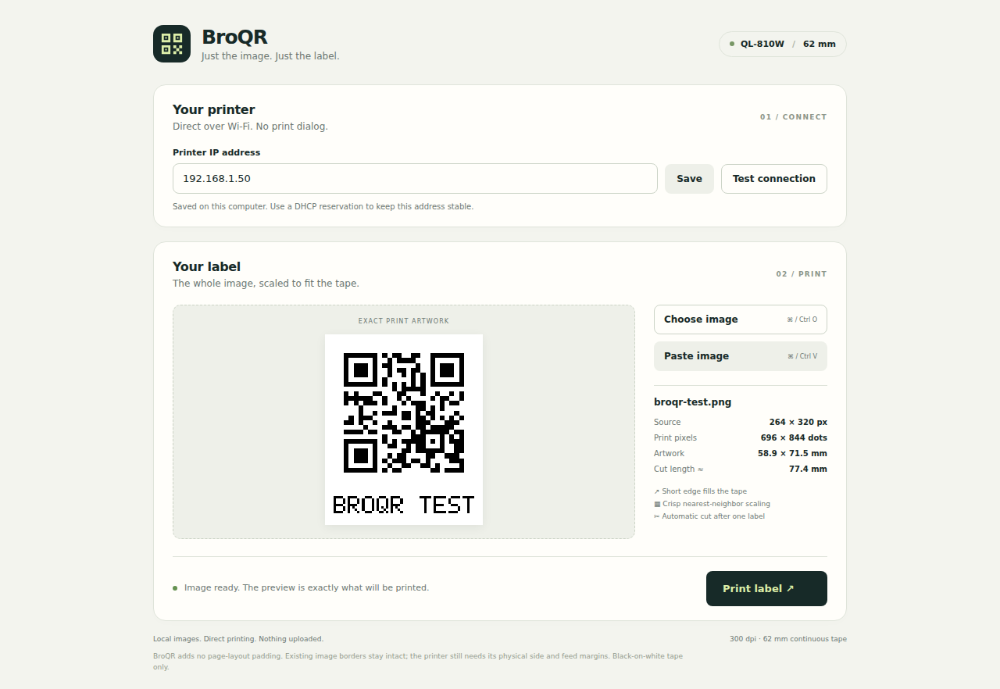

# BroQR

[](https://github.com/idan/broqr/actions/workflows/ci.yml)

A small Tauri + Rust desktop app for printing images directly to a **Brother
QL-810W over Wi-Fi**, using **62 mm (2.4″) continuous black-on-white tape**.

Drop, choose, or paste an image; preview it; print one label and automatically cut
it. No system print dialog, printer driver, Python runtime, cloud service, or QR
decoding is involved.



## Image sizing

- Preserve **all** image content: QR, bottom text, and existing white borders.
- Rotate landscape images clockwise so the shorter edge runs across the tape.
- Scale that edge to **696 dots**, the tape's printable width, at **300 dpi**.
- Use **nearest-neighbor** resampling and a fixed black/white threshold (128);
  **no smoothing and no dithering**.
- Composite transparent pixels onto white.
- Honor image orientation metadata before deciding which edge is shorter.
- Print exactly the pixels shown in the monochrome preview, from an in-memory
  snapshot rather than reopening the source file.

For example, 800 × 1000 becomes 696 × 870. A 1000 × 800 image becomes the same
size after a 90° rotation. No automatic crop, whitespace removal, or QR
regeneration is performed.

696 dots correspond to approximately **58.9 mm** of artwork width. The printer
still has physical side margins. Continuous tape also requires a minimum
**35-dot / approximately 3 mm feed margin at each end**. The app's cut-length
estimate includes these two margins; actual cutter behavior may vary. BroQR adds
no other page-layout padding.

Existing QR quiet zones are preserved, **not repaired or added**. An input code
that already lacks its required white border, or is too blurry/low-resolution,
may remain unscannable. Test an actual printed return code before relying on it.

## Run the desktop app

Install:

- A current stable [Rust toolchain](https://rustup.rs/) (dependencies require Rust
  1.88 or newer; latest stable recommended).
- [Node.js](https://nodejs.org/) **22.12 or newer** (24 LTS recommended).
- **Windows:** Visual Studio Build Tools with the **Desktop development with C++**
  workload and the Windows SDK; Microsoft Edge WebView2 Runtime. Use the default
  MSVC Rust toolchain.
- **macOS:** Xcode Command Line Tools (`xcode-select --install`).

Then, from this directory:

```sh
npm ci
npm run desktop:dev
```

In the app:

1. Enter the printer's Wi-Fi IP address, then **Save** or **Test connection**.
2. Drop an image into the window, **Choose image**, or **Paste image**.
3. Check the preview and estimated cut length.
4. Click **Print label**.

Keyboard shortcuts: **Ctrl/⌘ O** to choose, **Ctrl/⌘ V** to paste an image (outside
text fields), and **Ctrl/⌘ Enter** to print.

The printer address is saved in the platform's application configuration
directory under `com.broqr.desktop/settings.json`. Images stay only in memory;
the app does not retain copies or upload them.

The computer and printer must be reachable on the same network, with raw TCP
printing on port **9100** enabled. A DHCP reservation is recommended. An explicit
IP/port pair is accepted too, e.g. `192.168.1.50:9100` or `[::1]:9100`. Hostnames
and printer discovery are intentionally not implemented.

## Build installers

On each target OS:

```sh
npm run desktop:build
```

Outputs are in `target/release/bundle/`:

- Windows: NSIS installer / MSI.
- macOS: application bundle / DMG.

One codebase, separate platform builds. [GitHub Actions](https://github.com/idan/broqr/actions)
tests the core and frontend on Windows/macOS/Linux, then builds Windows x64
installers and a **universal macOS DMG** (Intel + Apple Silicon).

Every successful push to `main` creates a **new draft prerelease** with those
installers attached, after all tests and platform builds pass. Drafts use tags
like `main-build-12-abc1234`, tied to the exact commit; the application version
is not automatically bumped. Nothing is published automatically.

Find your drafts on the [Releases page](https://github.com/idan/broqr/releases)
while signed in as the owner/collaborator. Installers are also kept as Actions
artifacts for 30 days. Re-running a workflow updates the same draft; it refuses
to overwrite a release you have already published. Manual workflow runs on
`main` can create drafts too. Branch/PR builds do not create releases, and older
main builds are not automatically canceled.

Builds are **unsigned** unless you configure Tauri's signing/notarization
credentials. Windows SmartScreen and macOS Gatekeeper may warn about unsigned
builds. For your own Mac, running from source is the simplest initial test; for
distribution, sign and notarize normally rather than disabling security settings.

Linux desktop builds are also possible, but require Tauri's native packages,
typically `libwebkit2gtk-4.1-dev build-essential libssl-dev librsvg2-dev
libayatana-appindicator3-dev`. See
[Tauri prerequisites](https://v2.tauri.app/start/prerequisites/).

## Rust CLI (no desktop/webview dependencies)

The workspace defaults to the core and CLI, so these commands also work on
headless systems without GTK/WebKit.

Prepare and inspect without printing:

```sh
cargo run -p broqr-cli -- prepare return.png --preview preview.png --raster label.bin
```

Check the printer without printing:

```sh
cargo run -p broqr-cli -- check --printer 192.168.1.50
```

Print one label:

```sh
cargo run -p broqr-cli -- print --printer 192.168.1.50 return.png
```

Install the standalone CLI locally with
`cargo install --path crates/broqr-cli --locked`.

## Printing and status behavior

The Rust encoder implements Brother's documented QL-8xx raster protocol directly:
400-byte invalidate, initialization, raster mode, automatic status notifications,
62 mm continuous media, quality-priority 300 dpi monochrome, minimum feed margins,
uncompressed 90-byte raster rows with 12 unused pins on each side, and final
print/feed/auto-cut.

Before sending a job, BroQR requests printer status without clearing an active
job. If a response is available, it checks the **QL-810W model**, **62 mm
continuous media**, errors, and ready state. Wrong media, open cover, busy
printer, etc. stop the job when reported.

Some network configurations expose a write-only/raw endpoint without status
replies. BroQR can still send a job in that case. The UI distinguishes:

- **Printing completed:** the printer explicitly confirmed completion.
- **Label sent, unconfirmed:** all bytes were sent, but no completion status
  arrived. Check the physical printer before printing again.

No job is automatically retried. The UI and backend both prevent overlapping
print requests from this app. Other apps/computers should not print to the same
device simultaneously. A send failure can leave a partial job in the printer;
follow its normal recovery procedure and inspect it before retrying.

**Only ordinary black-on-white tape is supported in this version.** The
black/red DK-22251 roll requires a different raster mode and is not supported.
The generic media status does not reliably distinguish its color capability.

## Development and tests

```sh
npm run check
```

Equivalent checks:

```sh
npm run build
npm test
cargo fmt --all -- --check
cargo test --locked
cargo clippy --locked --all-targets -- -D warnings
```

`npm run dev` is a browser-only UI preview, **not** the desktop app. Native image
selection, clipboard access, and printing are disabled there. Use
`npm run desktop:dev` for real functionality.

### Physical printer smoke test

Generate a synthetic QR with a text line underneath (not an Amazon return code):

```sh
cargo run -p broqr-core --example test_image -- broqr-test.png
cargo run -p broqr-cli -- prepare broqr-test.png --preview preview.png
```

Open `broqr-test.png` in the desktop app, or print it with the CLI. Check that
the bottom text is present and readable, then scan the printed QR. Its payload
should be `BROQR TEST - NOT AN AMAZON RETURN CODE`. Try one of your real return
images next, keeping any original quiet-zone border intact.

Tests cover sizing, bottom-content preservation, rotation, transparency,
monochrome preview parity, golden raster commands/bit packing, a generated QR
that remains decodable after scaling, mock TCP printer status/transfer behavior,
and UI print/paste/error/concurrency behavior. They do **not** replace a real
printer test on the QL-810W.

Supported file formats: PNG, JPEG, WebP, BMP, GIF, TIFF. Animated/multi-page
formats use a single image; PDF/HEIC/SVG are not supported. Input limits are
32 MiB and 64 megapixels; overlong labels are rejected rather than cropped or
silently shrunk.

### Project layout

```text
src/                  TypeScript interface and UI tests
src-tauri/            Native desktop commands, settings, clipboard, packaging
crates/broqr-core/    Image preparation, Brother raster encoder, TCP/status
crates/broqr-cli/     Standalone Rust CLI
.github/workflows/   Cross-platform tests and installer builds
```

Protocol reference:
[Brother QL-800 / QL-810W / QL-820NWB Raster Command Reference v1.01](https://download.brother.com/welcome/docp100278/cv_ql800_eng_raster_101.pdf),
particularly sections 2.1, 2.3.3–2.3.5, and 4.
